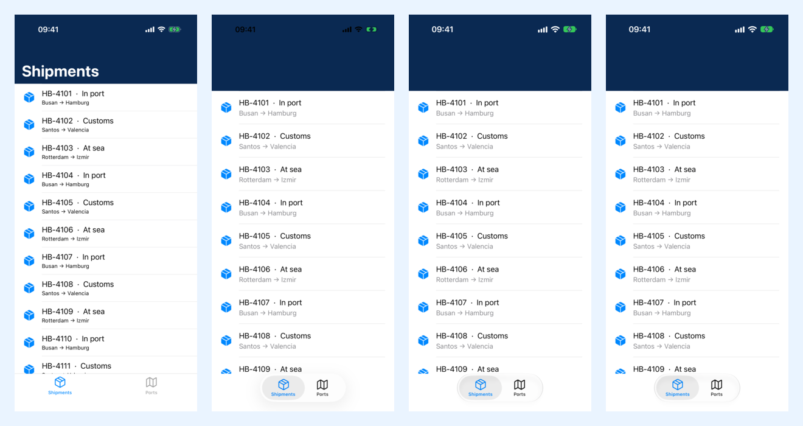
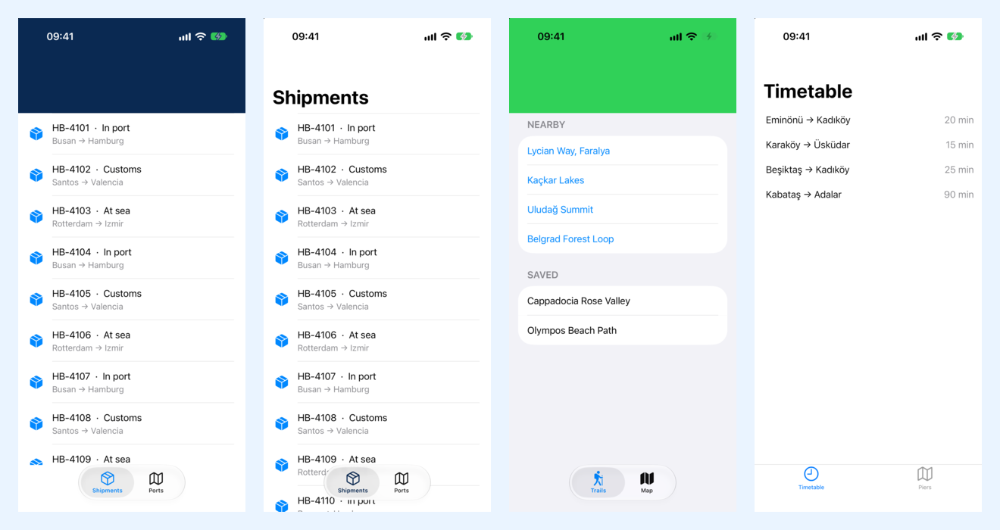

<!-- i18n-source: README.md@9196f58b96864395911d2d092b128cd308d8cce4 status=reviewed -->
<!-- brand:start -->

<p align="center"><picture><source media="(prefers-color-scheme: dark)" srcset="https://raw.githubusercontent.com/muhittincamdali/glassready/main/.github/brand/banner-dark.svg"><source media="(prefers-color-scheme: light)" srcset="https://raw.githubusercontent.com/muhittincamdali/glassready/main/.github/brand/banner-light.svg"></picture></p>

<!-- lang-selector:start -->
<p align="center"><a href="README.md">English</a> · <a href="README.tr.md">Türkçe</a> · <a href="README.zh-CN.md">简体中文</a> · <a href="README.ja.md">日本語</a> · <a href="README.ko.md">한국어</a> · <a href="README.es.md">Español</a> · <a href="README.de.md">Deutsch</a> · <a href="README.fr.md">Français</a> · <a href="README.pt-BR.md">Português (Brasil)</a> · <a href="README.ru.md">Русский</a></p>
<!-- lang-selector:end -->

<p align="center">
<a href="https://github.com/muhittincamdali/glassready/actions/workflows/ci.yml"></a>
<a href="https://github.com/muhittincamdali/glassready/releases"><picture><source media="(prefers-color-scheme: dark)" srcset="https://raw.githubusercontent.com/muhittincamdali/glassready/main/.github/brand/badge-version-dark.svg"><source media="(prefers-color-scheme: light)" srcset="https://raw.githubusercontent.com/muhittincamdali/glassready/main/.github/brand/badge-version-light.svg"></picture></a>
<a href="https://github.com/muhittincamdali/glassready/blob/main/package.json"><picture><source media="(prefers-color-scheme: dark)" srcset="https://raw.githubusercontent.com/muhittincamdali/glassready/main/.github/brand/badge-language-dark.svg"><source media="(prefers-color-scheme: light)" srcset="https://raw.githubusercontent.com/muhittincamdali/glassready/main/.github/brand/badge-language-light.svg"></picture></a>
<a href="https://github.com/muhittincamdali/glassready/blob/main/LICENSE"><picture><source media="(prefers-color-scheme: dark)" srcset="https://raw.githubusercontent.com/muhittincamdali/glassready/main/.github/brand/badge-license-dark.svg"><source media="(prefers-color-scheme: light)" srcset="https://raw.githubusercontent.com/muhittincamdali/glassready/main/.github/brand/badge-license-light.svg"></picture></a>
</p>

<p align="center">
<a href="#빠른-시작"><picture><source media="(prefers-color-scheme: dark)" srcset="https://raw.githubusercontent.com/muhittincamdali/glassready/main/.github/brand/button-start-ko-dark.svg"><source media="(prefers-color-scheme: light)" srcset="https://raw.githubusercontent.com/muhittincamdali/glassready/main/.github/brand/button-start-ko-light.svg"></picture></a>
<a href="https://muhittincamdali.github.io/glassready/"><picture><source media="(prefers-color-scheme: dark)" srcset="https://raw.githubusercontent.com/muhittincamdali/glassready/main/.github/brand/button-docs-ko-dark.svg"><source media="(prefers-color-scheme: light)" srcset="https://raw.githubusercontent.com/muhittincamdali/glassready/main/.github/brand/button-docs-ko-light.svg"></picture></a>
<a href="https://github.com/muhittincamdali/glassready/tree/main/docs/guides"><picture><source media="(prefers-color-scheme: dark)" srcset="https://raw.githubusercontent.com/muhittincamdali/glassready/main/.github/brand/button-guides-ko-dark.svg"><source media="(prefers-color-scheme: light)" srcset="https://raw.githubusercontent.com/muhittincamdali/glassready/main/.github/brand/button-guides-ko-light.svg"></picture></a>
<a href="https://github.com/muhittincamdali/glassready/tree/main/examples"><picture><source media="(prefers-color-scheme: dark)" srcset="https://raw.githubusercontent.com/muhittincamdali/glassready/main/.github/brand/button-examples-ko-dark.svg"><source media="(prefers-color-scheme: light)" srcset="https://raw.githubusercontent.com/muhittincamdali/glassready/main/.github/brand/button-examples-ko-light.svg"></picture></a>
</p>

> 이 문서는 영어 README의 번역본입니다. 내용이 다를 경우 영어 버전이 최신입니다.

<!-- brand:end -->

Liquid Glass 적용을 `UIDesignRequiresCompatibility`로 미뤄 두었다면, iOS 27 SDK는 이 키를 무시합니다.
Xcode 27로 빌드한 앱은 Info.plist에 무엇이 적혀 있든 iOS 27에서 Liquid Glass로 표시됩니다.
glassready는 네이티브 iOS, Flutter, React Native/Expo 프로젝트를 읽어 무엇이 바뀌는지 목록으로 보여 줍니다.
옵트아웃 키와, 앱이 Liquid Glass가 그리는 바와 시트를 덧칠하거나 가리거나 크기를 측정하는 모든 위치를 찾아 각각의 해결 방법과 함께 알려 줍니다.
프로젝트 파일을 읽기만 하며, 빌드하거나 실행하거나 아무것도 변경하지 않습니다.

<picture><source media="(prefers-color-scheme: dark)" srcset="docs/media/demo-uikit-optout-dark.svg"><source media="(prefers-color-scheme: light)" srcset="docs/media/demo-uikit-optout-light.svg"></picture>

<sub>실제 CLI로 <a href="fixtures/native-uikit-optout">native-uikit-optout
fixture</a>를 실행해 녹화했습니다. 테스트용으로 작성한 UIKit 앱입니다(<code>npm run demo</code>).</sub>

## 주요 기능

- **옵트아웃이 어디에 있든 찾아냅니다.** Info.plist 안, 빌드 설정인 `INFOPLIST_KEY_UIDesignRequiresCompatibility`(Xcode 27.1은 이 값을 생성되는 Info.plist에 복사조차 하지 않습니다), 또는 Expo 설정에서 찾습니다.
- **무엇이 Liquid Glass를 가리는지 보여 줍니다.** 네이티브 코드에서는 불투명한 바 appearance, `barTintColor`, SwiftUI toolbar 배경, 커스텀 tab bar, 블러 레이어, 시트 배경, 고정된 바 높이, 대문자로 쓴 섹션 헤더를 찾습니다. React Native와 Expo에서는 헤더 색상, JavaScript로 그린 tab bar, 무시되는 tab bar prop을 찾습니다. Flutter에서는 Flutter가 직접 그리는 Cupertino 바와 UIKit platform view를 찾습니다.
- **사용하는 코드 유형에 맞는 해결 방법을 제시합니다.** UIKit, SwiftUI, React Native, Expo, Flutter별로 가이드가 있으며, 앱이 이미 사용하는 Liquid Glass API 목록도 제공합니다.
- **모든 규칙에 출처가 있습니다.** 규칙은 데이터([rules/liquid-glass.json](rules/liquid-glass.json))이며 Apple, React Navigation, Expo, Flutter의 공식 페이지를 인용합니다. 출처가 없는 규칙이 있으면 테스트가 실패합니다.
- **시뮬레이터에서 확인했습니다.** Xcode 27.1로 빌드한 같은 앱은 키가 있든 없든 iOS 27.0에서 같은 화면을 보여 주고, iOS 26.4에서는 서로 다른 두 가지 디자인을 보여 줍니다. 녹화와 스크린샷은 저장소에 있습니다.
- **CI에 맞게 만들었습니다.** 터미널, 일반 텍스트, Markdown, JSON 리포트와 종료 코드(0은 문제 없음, 1은 발견 사항 있음, 2는 사용법 오류)를 제공합니다.

## 빠른 시작

**1. glassready를 설치합니다.** Node.js도 함께 설치하는 [Homebrew](https://brew.sh/)를 사용하는 경우:

```sh
brew install muhittincamdali/tap/glassready
```

또는 npm 레지스트리에서 npm으로 설치합니다. [Node.js](https://nodejs.org/) 22.12 이상이 필요합니다(`node --version`으로 확인할 수 있습니다):

```sh
npm i -g @mcamdali/glassready
```

설치하지 않고 실행하려면 `npx @mcamdali/glassready`를 사용합니다. 각 [GitHub release](https://github.com/muhittincamdali/glassready/releases/tag/v0.1.3)에는 같은 패키지가 tarball로 `SHA256SUMS` 파일과 함께 들어 있어, release를 고정하거나 검증할 때 쓸 수 있습니다.

**2. 앱 폴더에서 터미널을 엽니다.** `.xcodeproj`, `pubspec.yaml` 또는 `package.json`이 있는 폴더입니다.

```sh
cd path/to/YourApp
```

**3. glassready를 실행합니다.**

```sh
glassready
```

**4. 프로젝트 이름 아래의 줄을 읽습니다.** "The Liquid Glass opt-out is ignored"(Liquid Glass 옵트아웃이 무시됨)라고 나오면, 옵트아웃했더라도 iOS 27에서 앱이 바뀐다는 뜻입니다. 먼저 **ERROR**를 확인하고, 그다음 코드가 새 바를 덧칠하는 위치인 **WARNING** 발견 사항을 확인하세요. **INFO** 발견 사항은 iOS 27 시뮬레이터에서 한 번 살펴볼 만합니다. 각 발견 사항에는 "How to fix" 목록에 있는 해결 방법의 이름이 표시됩니다.

## iOS 27 SDK로 빌드하면 무엇이 바뀌는가

Apple의
[UIDesignRequiresCompatibility](https://developer.apple.com/documentation/bundleresources/information-property-list/uidesignrequirescompatibility)
페이지에서 발췌합니다.

> The system ignores this key when you build for iOS 27 or later, iPadOS 27 or later, Mac Catalyst
> 27 or later, macOS 27 or later, or tvOS 27 or later.

같은 UIKit 앱을 Xcode 27.1로 키가 있는 상태와 없는 상태로 두 번 빌드하고, iPhone 17 시뮬레이터에서 스크린샷을 비교했습니다([방법](docs/guides/opt-out.md#what-we-saw-in-the-simulator)).

| 시뮬레이터 | 키가 있을 때와 없을 때 같은 화면인가?                                                         |
| ---------- | --------------------------------------------------------------------------------------------- |
| iOS 27.0   | 예: 홈 인디케이터 위쪽에서 다른 픽셀이 0개이며, 키는 무시됩니다                               |
| iOS 26.4   | 아니요: 3,089,772개 픽셀 중 361,909개가 다르며, 키가 있으면 앱이 이전 SDK의 디자인을 유지합니다 |

<p align="center"></p>

따라서 Info.plist에 키가 남아 있는 동안에는 하나의 빌드가 두 가지 디자인을 보여 줍니다. iOS 26에서는 이전 디자인, iOS 27에서는 Liquid Glass입니다. Apple의
[Adopting Liquid Glass](https://developer.apple.com/documentation/technologyoverviews/adopting-liquid-glass)
는 이어서 검토할 항목을 나열하며, 아래 규칙은 이를 따릅니다.

업로드에 어떤 SDK를 사용해야 하는지는 App Store Connect가 Apple의
[Upcoming Requirements](https://developer.apple.com/news/upcoming-requirements/) 페이지에서 정합니다. 2026년 10월 27일 기준으로는 iOS 26 SDK가 포함된 Xcode 26이었습니다(2026년 4월 28일부터). 이것이 iOS 27 SDK로 바뀌면 첫 번째 행의 내용이 모든 업로드에 적용됩니다.

## glassready가 검사하는 항목

| 규칙   | 심각도  | 발견 사항                                                                                                     | 코드               |
| ------ | ------- | ------------------------------------------------------------------------------------------------------------- | ------------------ |
| GLS001 | error   | Info.plist, 빌드 설정 또는 Expo 설정에서 `UIDesignRequiresCompatibility`가 YES                                | 전체               |
| GLS002 | warning | `configureWithOpaqueBackground()`를 쓰거나 자체 배경색, 이미지, 효과, 그림자를 가진 바 appearance            | UIKit              |
| GLS003 | warning | `barTintColor`, `isTranslucent = false`, 바의 배경 또는 그림자 이미지                                         | UIKit              |
| GLS004 | warning | `.automatic`이 아닌 `toolbarBackground` / `toolbarBackgroundVisibility`                                       | SwiftUI            |
| GLS005 | warning | `UITabBar` 또는 `UIToolbar` 서브클래스, 또는 커스텀 tab bar를 위해 숨긴 시스템 tab bar                        | UIKit, SwiftUI     |
| GLS006 | info    | `UIGlassEffect`를 쓰지 않는 파일의 `UIBlurEffect` 뷰                                                          | UIKit              |
| GLS007 | warning | `presentationBackground` 또는 popover의 `backgroundColor`                                                     | SwiftUI, UIKit     |
| GLS008 | info    | safe-area inset에 더한 숫자, 레이아웃을 위해 읽은 바의 frame 높이, 49 또는 83포인트 tab bar                   | Flutter 제외 전체  |
| GLS009 | info    | 대문자로 쓴 섹션 헤더                                                                                         | SwiftUI            |
| GLS101 | warning | `headerStyle.backgroundColor`, `headerBackground` 또는 `headerBlurEffect`가 있는 네이티브 stack 헤더          | React Native, Expo |
| GLS102 | info    | JavaScript로 그린 tab bar: `createBottomTabNavigator`, Expo Router `Tabs`, 커스텀 `tabBar`                    | React Native, Expo |
| GLS103 | info    | iOS 26 이상에서 무시되는 네이티브 tab bar prop(`backgroundColor`, `blurEffect` 등)                            | React Native, Expo |
| GLS104 | warning | 4.30.0보다 오래된 `react-native-screens`를 쓰는 네이티브 bottom tabs                                          | React Native       |
| GLS201 | info    | Flutter가 직접 그리는 Cupertino 바                                                                            | Flutter            |
| GLS202 | info    | Flutter 위젯 옆에 UIKit 컨트롤이 있는 `UiKitView`                                                             | Flutter            |

규칙 데이터는 `liquid-glass@2026.10.27`이며 Xcode 27.1(27A9275)을 기준으로 확인했습니다. 리포트에는 앱이 이미 사용하는 Liquid Glass API(`UIGlassEffect`, `glassEffect`, glass 버튼 스타일, `safeAreaBar`, `NativeTabs` 등)와 영향 점수도 함께 나옵니다. 점수는 옵트아웃 50점, warning 하나당 6점, info 발견 사항 하나당 2점이며 최대 100점입니다. 이 점수는 프로젝트를 정렬하기 위한 것이며 디자인을 평가하지 않습니다.

## 설치

빠른 시작의 명령은 npm 레지스트리에서 `glassready` 명령을 설치합니다. 프로젝트에 추가하려면:

```sh
npm install --save-dev @mcamdali/glassready
```

그다음에는 `npx glassready`가 그 사본을 실행합니다. 패키지는 `@mcamdali/glassready`라는 이름으로 설치되며, 아래 JavaScript API도 이 이름으로 import합니다. release를 고정하거나 검증하려면 각 [GitHub release](https://github.com/muhittincamdali/glassready/releases)에 패키지가 `glassready-<version>.tgz`로 `SHA256SUMS` 파일과 함께 들어 있습니다. `npm install --save-dev`는 패키지 이름 대신 이 tarball URL도 받습니다.

## 사용법

```text
glassready [path] [options]
```

| 옵션                    | 설명                                                                       |
| ----------------------- | -------------------------------------------------------------------------- |
| `path`                  | 프로젝트 폴더 또는 `.xcodeproj`. 기본값은 현재 폴더                        |
| `-f, --format <format>` | `tty`(기본값), `text`, `markdown`, `json`                                  |
| `--json`                | `--format json`과 같음                                                     |
| `-o, --output <file>`   | 리포트를 터미널 대신 파일에 기록                                           |
| `--fail-on <severity>`  | `warning`(기본값), `error`, `info`, `none`: 종료 코드가 1이 되는 기준      |
| `--no-color`            | 터미널에서도 일반 텍스트로 출력(`NO_COLOR`와 `FORCE_COLOR`를 따름)         |

종료 코드: `0`은 `--fail-on` 이상인 항목이 없음, `1`은 그 이상인 발견 사항이 있음, `2`는 잘못된 인수, iOS 프로젝트를 찾지 못함, 또는 예기치 않은 오류입니다. Info.plist나 Xcode 프로젝트를 읽지 못해 옵트아웃을 확인할 수 없는 경우에도 `--fail-on none`이 아니면 `1`입니다.

glassready는 iOS 앱을 스스로 찾습니다. 네이티브 앱은 루트 또는 한 단계 아래 폴더의 `.xcodeproj`, Flutter·React Native·Expo 앱은 `ios/`(Flutter 플러그인은 `example/ios/`)입니다. iOS 앱 타깃마다 Info.plist(XML 또는 바이너리)와 빌드 설정, 앱의 Swift와 Objective-C 파일, React Native 또는 Expo 앱의 JavaScript와 TypeScript, `lib/`의 Dart 파일을 읽으며, 의존성과 빌드 결과물, 테스트는 건너뜁니다. `ios/`가 없는 Expo 앱은 설정만으로 검사합니다.

### Markdown 리포트를 코드와 함께 보관하기

```sh
glassready --format markdown --output glassready.md
```

### 스크립트에서 JSON 리포트 사용하기

```sh
glassready --json > glassready.json
```

각 발견 사항에는 `rule`, `severity`, `title`, `message`, `file`, `line`, `target`, 단계와 가이드를 담은 `fix`, 그리고 `sources`가 있습니다. 형식은 `schemaVersion` 0이며 1.0 이전에 바뀔 수 있습니다. [examples/shell/opt-out-targets.sh](examples/shell/opt-out-targets.sh)는 이를 `jq`로 걸러 냅니다.

### CI에서 실행하기

[examples/github-actions/glassready.yml](examples/github-actions/glassready.yml)은 앱을 건드리는 모든 pull request의 job 요약에 리포트를 추가하고, warning이 있으면 job을 실패시킵니다. `--fail-on error`는 무시되는 옵트아웃에서만 실패합니다.

### JavaScript에서 사용하기

```js
import { render, scan } from '@mcamdali/glassready';

const report = await scan('path/to/app');
console.log(report.verdict.text, report.impact.level);
console.log(render(report, 'markdown'));
```

실행해 볼 수 있는 버전은 [examples/api/impact.mjs](examples/api/impact.mjs)입니다.

## 데모

터미널 녹화는 각 툴체인으로 만든 프로젝트인 [fixtures](fixtures/README.md)에서 CLI를 실행해 얻은 것입니다.

| 프로젝트                                                              | 녹화                                                                                                                                        |
| --------------------------------------------------------------------- | ------------------------------------------------------------------------------------------------------------------------------------------- |
| 옵트아웃과 불투명한 바가 있는 UIKit 앱                                | 이 페이지 상단                                                                                                                              |
| 네이티브 stack과 JavaScript 탭이 있는 React Native 0.88.1 앱          | [라이트](docs/media/demo-react-native-light.svg) · [다크](docs/media/demo-react-native-dark.svg)                                            |
| Cupertino 바와 `UiKitView`가 있는 Flutter 3.47.5 앱                   | [라이트](docs/media/demo-flutter-light.svg) · [다크](docs/media/demo-flutter-dark.svg)                                                      |
| toolbar 배경과 커스텀 하단 바가 있는 SwiftUI 앱                       | [라이트](docs/media/demo-swiftui-light.svg) · [다크](docs/media/demo-swiftui-dark.svg)                                                      |
| iOS 27.0과 iOS 26.4에서 실행한 `scripts/simulator-compare.sh`         | [27.0](docs/media/demo-simulator-native-uikit-optout-27.0-light.svg) · [26.4](docs/media/demo-simulator-native-uikit-optout-26.4-light.svg) |

iOS 27.0 iPhone 17 시뮬레이터에서 Xcode 27.1로 빌드한 fixture 네 개입니다. 불투명한 남색 바가 있는 UIKit 앱(큰 제목은 표시되지 않음), 수정 후의 같은 앱, 초록색 toolbar 배경이 있는 SwiftUI 앱, Flutter가 그린 평평한 tab bar가 있는 Flutter 앱입니다.

<p align="center"></p>

2026년 10월 27일에 Mac(Apple silicon, M5 Max)에서 Node.js 26.11로 측정했습니다. fixture 일곱 개에 대해 `node dist/cli/main.js --json`을 100번 실행하는 세트를 세 번 수행했으며, Node.js 시작 시간이 포함됩니다. 세 세트의 중앙값은 0.12초, 0.12초, 0.11초였고, 가장 느린 실행은 0.17초가 걸렸습니다.

## 상태

| 기능                                                                                          | 상태          |
| --------------------------------------------------------------------------------------------- | ------------- |
| 네이티브, Flutter(앱과 플러그인 예제), React Native, Expo 프로젝트 감지                       | 동작          |
| Info.plist, 빌드 설정, Expo 설정에서의 GLS001(app.json, app.config.js/ts는 텍스트로 처리)     | 동작          |
| Swift와 Objective-C에서 GLS002부터 GLS009까지, JavaScript와 TypeScript에서 GLS101부터 GLS104까지 | 동작       |
| Dart에서 GLS201과 GLS202                                                                      | 동작          |
| 터미널, 텍스트, Markdown, JSON 리포트, 영향 점수, 사용 중인 API, `--fail-on` 종료 코드        | 동작          |
| 의존성(Pods, `node_modules`, Flutter 플러그인)과 `.xcconfig` 빌드 설정                        | 계획됨(0.2)   |
| SARIF 출력과 GitHub Action                                                                    | 계획됨(0.3)   |
| 패턴 대신 Swift 구문 트리 사용, CLI에서 시뮬레이터 스크린샷 촬영                              | 계획됨(0.5)   |
| 안정적인 규칙 스키마와 JSON 형식                                                              | 계획됨(1.0)   |

## 한계

- **컴파일러가 아니라 패턴입니다.** 규칙은 주석과 문자열을 비워 둔 소스 텍스트에 대한 정규식입니다. 생성된 코드, 매크로 뒤에 숨은 코드, 실행 중에 만들어지는 코드, 특이한 형태로 작성된 코드는 놓치거나 잘못 일치시킬 수 있습니다.
- **앱 자체의 소스만 봅니다.** 규칙은 앱 자체의 코드에 적용됩니다. Pods, 앱 폴더 밖의 Swift 패키지, `node_modules`, Flutter 플러그인의 소스는 읽지 않습니다. `node_modules`에서는 glassready가 살펴보는 React Native와 Expo 패키지(`react-native`, `expo`, `react-native-screens` 외 8개)의 `<name>/package.json`만 설치된 버전을 알기 위해 읽습니다. `node_modules/<name>` 폴더 밖을 가리키는 링크인 파일은 읽지 않습니다.
- **빌드 설정은 project.pbxproj에서만 읽습니다.** `.xcconfig` 파일은 읽지 않습니다. 타깃의 Info.plist를 읽을 수 없으면 옵트아웃 상태는 "알 수 없음"이 되며, 리포트가 그 이유를 알려 줍니다. Xcode 프로젝트를 읽을 수 없을 때도 마찬가지이며, 이때 판정은 "Opt-out not known"이고 준비 완료로 표시되지 않습니다.
- **Expo 설정은 텍스트로 읽습니다.** `app.config.js`와 `app.config.ts`는 실행하지 않으므로, 변수나 config plugin을 통해 설정한 옵트아웃은 찾지 못합니다.
- **파일만 봅니다.** glassready는 앱을 빌드하거나 앱 화면을 보지 않습니다. 이 저장소의 시뮬레이터 녹화는 Mac에서 실행한 `scripts/`의 스크립트로 만든 것입니다.
- **입력에는 한도가 있습니다.** 프로젝트는 pull request에서 올 수도 있으므로, glassready는 프로젝트 파일당 최대 32 MB, 소스는 파일당 4 MB, 최대 20,000개 파일, 합계 128 MB까지만 읽습니다. 읽지 않은 것은 리포트의 참고 사항에 나열됩니다. 바이너리 plist가 만들 수 있는 값은 최대 100,000개이고, plist와 JSON 파일(package.json, package-lock.json, app.json)은 최대 64단계까지 중첩될 수 있으며 그보다 깊은 JSON 파일은 파싱하지 않습니다. Mac (Apple silicon)과 Node 26에서 package.json, package-lock.json, `node_modules`의 package.json 4개가 각각 31 MB의 중첩 배열인 프로젝트는 0.2초, 최대 190 MB 메모리로 검사됩니다.

## 문서

API 레퍼런스와 가이드: [muhittincamdali.github.io/glassready](https://muhittincamdali.github.io/glassready/).

## 가이드

- [Liquid Glass 옵트아웃이 더 이상 동작하지 않는 이유](docs/guides/opt-out.md)
- [네이티브 UIKit 및 SwiftUI 앱](docs/guides/native-ios.md)
- [React Native 및 Expo 앱](docs/guides/react-native-expo.md)
- [Flutter 앱](docs/guides/flutter.md)

## 출처

2026년 10월 27일에 확인했습니다.

- Apple: [UIDesignRequiresCompatibility](https://developer.apple.com/documentation/bundleresources/information-property-list/uidesignrequirescompatibility),
  [Adopting Liquid Glass](https://developer.apple.com/documentation/technologyoverviews/adopting-liquid-glass),
  [Upcoming Requirements](https://developer.apple.com/news/upcoming-requirements/), 그리고 각 규칙이
  [rules/liquid-glass.json](rules/liquid-glass.json)에서 링크하는 API 페이지.
- React Navigation: [Native Stack](https://reactnavigation.org/docs/native-stack-navigator/),
  [Bottom Tabs](https://reactnavigation.org/docs/bottom-tab-navigator/),
  [Native Bottom Tabs](https://reactnavigation.org/docs/native-bottom-tab-navigator/).
- Expo: [JavaScript tabs](https://docs.expo.dev/router/advanced/tabs/),
  [Native tabs](https://docs.expo.dev/router/advanced/native-tabs/),
  [app config `ios.infoPlist`](https://docs.expo.dev/versions/latest/config/app/).
- Flutter: [issue 170310](https://github.com/flutter/flutter/issues/170310),
  [cupertino_ui changelog](https://pub.dev/packages/cupertino_ui/changelog),
  [platform views on iOS](https://docs.flutter.dev/platform-integration/ios/platform-views).

## 요구 사항

macOS, Linux 또는 Windows에서 Node.js 22.12 이상. 프로젝트를 읽는 데 그 밖에 필요한 것은 없습니다. Xcode, Flutter, React Native 툴체인도 필요하지 않습니다. 시뮬레이터 스크립트에는 Xcode, XcodeGen, ImageMagick이 설치된 Mac이 필요합니다.

## 아키텍처

```text
detectProject      native | flutter | react-native | expo, the iOS folder, package versions
  ─► collectApp    app targets, Info.plist files, build settings, blanked sources
  ─► checkApp      GLS001 opt-out · GLS002–009 native · GLS101–104 React Native · GLS201–202 Flutter
                   rules/liquid-glass.json: what each rule says, fixes, sources (validated with zod)
  ─► scan          findings, verdict, impact score, adopted APIs
  ─► render        tty | text | markdown | json
```

- 규칙 데이터는 코드와 분리되어 있고 버전이 매겨져 있습니다(`liquid-glass@2026.10.27`). 규칙에 출처가 없거나 존재하지 않는 가이드를 가리키면 테스트가 실패합니다.
- CLI(`src/cli/`)는 인수를 해석하고, 색상과 너비를 정하고, 종료 코드를 설정하는 일만 합니다.

## 관련 프로젝트

[sdkbump](https://github.com/muhittincamdali/sdkbump)는 iOS 27 SDK에 관한 또 다른 질문, 즉 앱이 실행되는가에 답합니다. iOS 27 SDK로 빌드한 앱이 반드시 적용해야 하는 UIScene 생명 주기를 검사합니다. glassready는 앱이 어떻게 보이는가에 답합니다. 첫 Xcode 27 빌드 전에 둘 다 실행해 보세요.

## FAQ

**내 앱은 지금 iOS 27에서 실행되고 모양도 그대로입니다. 영향을 받나요?** Apple 문서는 이 변경을 앱을 빌드한 SDK에 연결합니다. 따라서 Xcode 26으로 만든 빌드는 디자인을 유지해야 합니다. 다만 여기에는 Xcode 27.1만 설치되어 있어서 확인하지 못했습니다. 다음에 Xcode 27로 빌드하면 키가 무시됩니다.

**GLS002 또는 GLS004 warning은 항상 버그인가요?** 아닙니다. 바에 브랜드 색상을 쓰는 것은 의도한 결정일 수 있습니다. 이 warning은 코드가 Liquid Glass가 그리는 바를 덧칠한다는 사실을 알려 줄 뿐입니다. iOS 27 시뮬레이터에서 화면을 보고 판단하세요.

**glassready가 내 프로젝트를 변경하나요?** 아니요. 프로젝트를 읽기만 하고, 요청한 리포트만 기록합니다.

## 기여하기

기여를 환영합니다. pull request를 열기 전에 [기여 가이드](CONTRIBUTING.md)와 [행동 강령](https://github.com/muhittincamdali/.github/blob/main/CODE_OF_CONDUCT.md)을 읽어 주세요. 보안 문제는 [보안 정책](SECURITY.md)에 따라 비공개로 제보해 주세요.

## 라이선스

MIT 라이선스로 배포됩니다. 자세한 내용은 [LICENSE](LICENSE)를 참고하세요.
