# Flutter apps

Flutter draws its widgets itself, so building with the iOS 27 SDK does not turn a
`CupertinoNavigationBar` or a `CupertinoTabBar` into Liquid Glass. What does change is everything
UIKit draws around the Flutter view: the keyboard, the share sheet, permission alerts, and native
views you embed with `UiKitView`. The `UIDesignRequiresCompatibility` opt-out in `ios/Runner/Info.plist`
no longer holds those back ([why](opt-out.md)).

```sh
npx @mcamdali/glassready path/to/your_app
```

<picture><source media="(prefers-color-scheme: dark)" srcset="../media/demo-flutter-dark.svg"><source media="(prefers-color-scheme: light)" srcset="../media/demo-flutter-light.svg"></picture>

## What we saw

The [flutter-cupertino](../../fixtures/README.md) fixture (Flutter 3.47.5) built with
Xcode 27.1 for an iPhone 17 simulator with iOS 27.0 keeps the flat, full-width `CupertinoTabBar`
Flutter draws (last screenshot in the [native guide](native-ios.md#gls002-and-gls003-bar-backgrounds-set-in-uikit)).

As of 27 October 2026, Liquid Glass for the Cupertino widgets is an open request in
[flutter/flutter#170310](https://github.com/flutter/flutter/issues/170310), and the
[cupertino_ui](https://pub.dev/packages/cupertino_ui/changelog) package (1.1.4), where new
Cupertino work now happens, lists no Liquid Glass change.

## GLS201: Cupertino bars drawn by Flutter

Information, not a warning: whether your bars should look like the system's is a design decision.

- To keep your design, nothing changes; check the screens next to system sheets and alerts on an
  iOS 27 simulator.
- To follow the system, restyle the bars yourself (a translucent background and a floating tab
  bar) or wait for framework support in the issue above.

## GLS202: UIKit views inside Flutter

A `UiKitView` shows a native view. Its UIKit controls take the Liquid Glass design, so a native map
with its own controls, or a native form, can look different from the Flutter widgets around it.

## The native side of the app

glassready also reads the Swift and Objective-C files under `ios/`, so an `AppDelegate` that styles
`UINavigationBar` or `UITabBar` (used by native screens or plugins) is reported with the native
rules ([native guide](native-ios.md)).
