# Why the Liquid Glass opt-out stops working

iOS 26 introduced Liquid Glass, and with it a way to postpone it: set
`UIDesignRequiresCompatibility` to `YES` in Info.plist and the app keeps the design of earlier
SDKs. Apple described the key as temporary from the start. Its documentation now says:

> The system ignores this key when you build for iOS 27 or later, iPadOS 27 or later, Mac Catalyst
> 27 or later, macOS 27 or later, or tvOS 27 or later.
>
> — [Apple: UIDesignRequiresCompatibility](https://developer.apple.com/documentation/bundleresources/information-property-list/uidesignrequirescompatibility)

Nothing in the build tells you. The key stays in the Info.plist, the app compiles without a
warning, and on an iOS 27 device it shows Liquid Glass.

## What we saw in the simulator

We built the [native-uikit-optout](../../fixtures/README.md) fixture with Xcode 27.1
(iOS 27.1 SDK) twice, once as it is and once without the key, and compared screenshots on an
iPhone 17 simulator with [scripts/simulator-compare.sh](../../scripts/simulator-compare.sh):

| Simulator | With `UIDesignRequiresCompatibility = YES`         | Same screen without the key? |
| --------- | -------------------------------------------------- | ---------------------------- |
| iOS 27.0  | floating Liquid Glass tab bar                      | yes: the key is ignored      |
| iOS 26.4  | full-width tab bar and large title of earlier SDKs | no: the key still applies    |

<picture><source media="(prefers-color-scheme: dark)" srcset="../media/demo-simulator-native-uikit-optout-27.0-dark.svg"><source media="(prefers-color-scheme: light)" srcset="../media/demo-simulator-native-uikit-optout-27.0-light.svg"></picture>

Two things follow from the second row:

1. **The same build ships two designs.** As long as the key is in the Info.plist, people on iOS 26
   see the old design and people on iOS 27 see Liquid Glass. Screenshots, support documents and
   design reviews made on one version do not match the other.
2. **Removing the key changes iOS 26 too.** Once you delete it, iOS 26 users get Liquid Glass as
   well, which is what you want: one design to test.

The screenshots compare the screen above the home indicator, allowing a difference of 2% per
colour channel, because the Liquid Glass material varies by up to 2 of 255 between two launches of
the same build. On iOS 27.0 no pixel differed by more than that; on iOS 26.4 about 12% of them did.

## The build-setting variant has no effect at all

Projects that let Xcode generate the Info.plist sometimes set
`INFOPLIST_KEY_UIDesignRequiresCompatibility = YES` as a build setting. With Xcode 27.1 the
generated Info.plist of the [native-swiftui](../../fixtures/README.md) fixture does not
contain the key, so this setting does nothing with that Xcode, on any iOS version. glassready
reports it as GLS001 like the Info.plist key, with the fix to delete the setting.

## When does this reach you?

When you build with Xcode 27. Apple's
[Upcoming Requirements](https://developer.apple.com/news/upcoming-requirements/) page sets the SDK
that App Store Connect accepts; on 27 October 2026 it listed Xcode 26 and the iOS 26 SDK, required
since 28 April 2026. When that minimum moves to the iOS 27 SDK, every upload is built the way the
table above describes. glassready does not assume a date.

## What to do

1. Run glassready to see where the app works against Liquid Glass:

   ```sh
   npx @mcamdali/glassready
   ```

2. Delete the key (or the build setting, or `ios.infoPlist.UIDesignRequiresCompatibility` in an
   Expo config, followed by `npx expo prebuild --clean -p ios`).
3. Fix the warnings first: they are the places where the app paints over the new bars. Then look
   at the info findings on an iOS 27 simulator.

Next: [native UIKit and SwiftUI apps](native-ios.md),
[React Native and Expo](react-native-expo.md), [Flutter](flutter.md).
