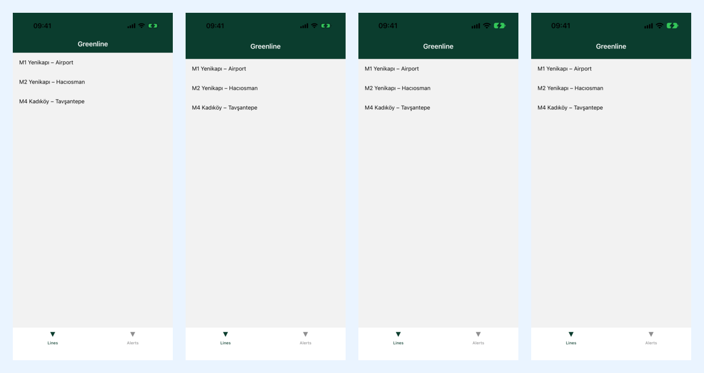

# React Native and Expo apps

A React Native app built with the iOS 27 SDK is a UIKit app underneath, so the parts of it that
are UIKit views take the Liquid Glass design and the parts drawn in JavaScript do not. The
`UIDesignRequiresCompatibility` opt-out no longer holds either back ([why](opt-out.md)).

```sh
npx @mcamdali/glassready path/to/your-app
```

| Part of the app                                                                 | Drawn by     | With the iOS 27 SDK                         |
| ------------------------------------------------------------------------------- | ------------ | ------------------------------------------- |
| Native stack header (`@react-navigation/native-stack`, Expo Router `Stack`)     | UIKit        | Liquid Glass, unless the app paints over it |
| Native bottom tabs (`createNativeBottomTabNavigator`, Expo Router `NativeTabs`) | UIKit        | Liquid Glass; background props are ignored  |
| JavaScript bottom tabs (`createBottomTabNavigator`, Expo Router `Tabs`)         | React Native | Unchanged                                   |
| System sheets, alerts, keyboard                                                 | UIKit        | Liquid Glass                                |

Sources: React Navigation's
[native stack](https://reactnavigation.org/docs/native-stack-navigator/),
[bottom tabs](https://reactnavigation.org/docs/bottom-tab-navigator/) and
[native bottom tabs](https://reactnavigation.org/docs/native-bottom-tab-navigator/) pages, and
Expo Router's [JavaScript tabs](https://docs.expo.dev/router/advanced/tabs/) and
[native tabs](https://docs.expo.dev/router/advanced/native-tabs/) pages.

<picture><source media="(prefers-color-scheme: dark)" srcset="../media/demo-react-native-dark.svg"><source media="(prefers-color-scheme: light)" srcset="../media/demo-react-native-light.svg"></picture>

## What we saw in the simulator

We built the [rn-088-js-tabs](../../fixtures/README.md) fixture (React Native 0.88.1,
react-native-screens 4.30.0, a native stack header painted green and JavaScript bottom tabs) as a
Release build with Xcode 27.1 (iOS 27.1 SDK), once as it is and once without
`UIDesignRequiresCompatibility`, and compared screenshots on an iPhone 17 simulator with
[scripts/simulator-compare.sh](../../scripts/simulator-compare.sh)
([iOS 27.0 record](../media/simulator/rn-088-js-tabs-27.0.txt),
[iOS 26.4 record](../media/simulator/rn-088-js-tabs-26.4.txt)):

| Simulator | Pixels that differ without the key (1206 × 2562) | Native stack header (top 400 rows) | JavaScript tab bar (189 rows) |
| --------- | ------------------------------------------------ | ---------------------------------- | ----------------------------- |
| iOS 27.0  | 0: the key is ignored                            | 0                                  | 0                             |
| iOS 26.4  | 92,543: the key still applies                    | 68,042                             | 0                             |

<p align="center"></p>

On iOS 26.4 the key decides how the native stack header looks: without it the header is the taller
Liquid Glass navigation bar with the title lower, and the list starts further down. The JavaScript
tab bar is the same pixels either way, because React Native draws it. On iOS 27.0 the build looks
the same with and without the key. The header keeps the green that `headerStyle.backgroundColor`
paints over it, which is what GLS101 reports.

The rows were compared with the same 2% tolerance as the whole screen:

```sh
magick compare -metric AE -fuzz 2% \
  \( rn-088-js-tabs-26.4-opt-out.png -crop 1206x400+0+0 +repage \) \
  \( rn-088-js-tabs-26.4-no-key.png -crop 1206x400+0+0 +repage \) null:   # 68042
magick compare -metric AE -fuzz 2% \
  \( rn-088-js-tabs-26.4-opt-out.png -crop 1206x189+0+2373 +repage \) \
  \( rn-088-js-tabs-26.4-no-key.png -crop 1206x189+0+2373 +repage \) null:   # 0
```

The tab bar rows start at 2373, the top of the 83-point (249-pixel) tab bar the fixture sets, and
stop at the home indicator. The script runs `npm install` and `pod install` in a copy of the
fixture, so it needs CocoaPods and network access.

## GLS001 in an Expo config

With continuous native generation the Info.plist comes from the Expo config:

```json
{ "expo": { "ios": { "infoPlist": { "UIDesignRequiresCompatibility": true } } } }
```

Delete the key and regenerate the native project with `npx expo prebuild --clean -p ios` (EAS Build
does this on its own). glassready reads `app.json`; `app.config.js` and `app.config.ts` are read as
text and never run, so a value that comes from a variable or a config plugin is not seen.

## GLS101: native stack header backgrounds

```tsx
<Stack.Navigator
  screenOptions={{
    headerStyle: { backgroundColor: '#0B3D2E' }, // GLS101
    headerBlurEffect: 'systemMaterial', // GLS101
  }}
/>
```

The header is a `UINavigationBar`; a background colour or a custom `headerBackground` paints over
the bar the system draws. React Navigation also notes that `headerBlurEffect` and the iOS 26 scroll
edge effects can overlap. Keep these for Android or older iOS with `Platform.select`, and put the
brand colour on `headerTintColor`.

## GLS102: tab bars drawn in JavaScript

`createBottomTabNavigator`, Expo Router's `Tabs` and a custom `tabBar` component draw the tab bar
in React Native. It keeps its look next to Liquid Glass headers and sheets. That can be a
deliberate brand choice; if you want the system bar instead:

- React Navigation: `createNativeBottomTabNavigator` from `@react-navigation/bottom-tabs/unstable`
  (React Native 0.79 or later, `react-native-screens` 4.30.0 or later; GLS104 checks the version).
- Expo Router: `NativeTabs` from `expo-router/native-tabs` in SDK 58, or
  `expo-router/unstable-native-tabs` in SDK 54 to 57.

## GLS103: native tab bar props iOS 26 ignores

Expo's documentation: on iOS 26 and later the system draws the tab bar with Liquid Glass and takes
its background from the content behind it; `backgroundColor`, `blurEffect`, `shadowColor` and
`disableTransparentOnScrollEdge` only affect iOS 18 and earlier. React Navigation says the same of
`tabBarStyle.backgroundColor` and `tabBarBlurEffect`. Even the `expo-template-default` 58.0.29
template sets `backgroundColor` on its `NativeTabs` (the [expo-58-default](../../fixtures/README.md)
fixture), which is why this is information, not a warning. Use `PlatformColor` or
`DynamicColorIOS` for icon colours, since the bar sits on light and dark content.

## GLS008: fixed tab bar heights

`tabBarStyle: { height: 83 }` copies the height of the old tab bar. Read the measured height with
`useBottomTabBarHeight()` or the safe-area insets instead.

## What glassready does not see

- Styles built at run time or spread from another file (`headerStyle: styles.header`).
- Navigation libraries other than React Navigation and Expo Router.
- Native code in `node_modules` and Pods.
